# Отчёт по практической работе «Создание теста командой из трёх студентов в Git»

## 1. Тема и цель
Командная разработка учебного теста по Git с использованием ветвления, Pull Requests, разрешения конфликтов и финальной QA-проверки.  
**Моя роль:** Студент C — QA (тестировщик). Цель моей части — проверить целостность репозитория, корректность всех 6 вопросов и файла ответов, а также оформить итоговый отчёт.

## 2. Состав команды
| Роль | ФИО | GitHub |
|------|-----|--------|
| Team Lead | Дульцев Данил | @Danilka35 |
| Разработчик (вопрос 3) | Фомина Юлия | @FominaUlia |
| Разработчик (вопрос 4) | Жданов Матвей| @Didji1 |
| QA-тестировщик | Главатских Александр | @Glavatskih |

## 3. Ссылка на репозиторий
https://github.com/Danilka35/quiz-project

## 4. Распределение задач
- **A:** вопросы 1–2, README, PR-координация, разрешение конфликта.
- **B1:** вопрос 3, участие в конфликте (`conflict/a`).
- **B2:** вопрос 4, участие в конфликте (`conflict/b`).
- **C:** вопросы 5–6, `answers.txt`, QA-проверка, отчёт.

## 5. Хронология работы
1. Создан репозиторий и структура — 10.11.2026
2. Ветки `feature/*` созданы — 11.10.2026
3. PR #1–#4 и merge в `main` — 11.10.2026
4. Ветки `conflict/a`, `conflict/b`, разрешение конфликта в `README.md` (PR #5) — 11.10.2026
5. Финальная QA-проверка, удаление `.gitkeep`, отчёт — 11.10.2026

## 6. Использованные команды Git

| Команда | Назначение |
|---------|-----------|
| `git clone` | Клонирование репозитория на локальный компьютер |
| `git checkout main` | Переключение на главную ветку |
| `git checkout -b feature/q5-q6` | Создание новой ветки для работы |
| `git pull origin main` | Получение и слияние изменений с удалённого репозитория |
| `git add` | Подготовка файлов к коммиту |
| `git commit -m "..."` | Фиксация изменений |
| `git push -u origin feature/q5-q6` | Отправка ветки на GitHub |
| `git branch -d feature/q5-q6` | Удаление локальной ветки после merge |
| `git status` | Проверка состояния рабочей директории |
| `git log --oneline --graph --all --decorate` | Просмотр истории коммитов в виде графа |
| `git rm questions/.gitkeep answers/.gitkeep` | Удаление временных файлов |

## 7. Скриншоты

### 7.1. Граф коммитов (`git log --graph`)
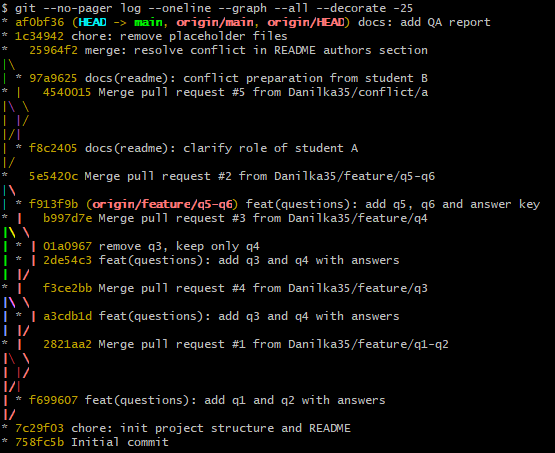

### 7.2. Список Pull Requests
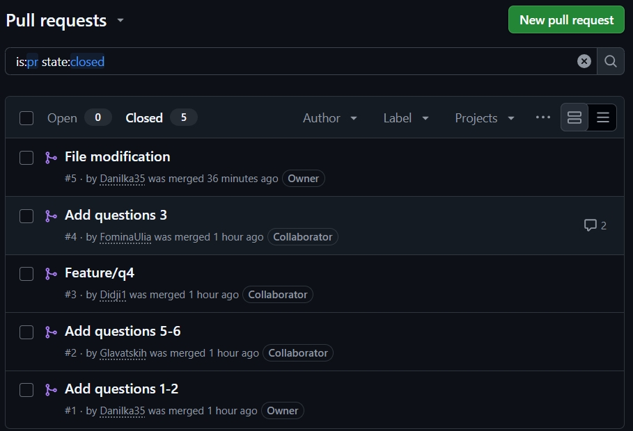

### 7.3. Момент конфликта (маркеры в README)
Конфликт разрешён студентами A и B. В итоговом `README.md` маркеры конфликта отсутствуют. Разрешение зафиксировано коммитом `25964f2 merge: resolve conflict in README authors section` — он виден в графе коммитов (пункт 7.1).

### 7.4. Успешный merge
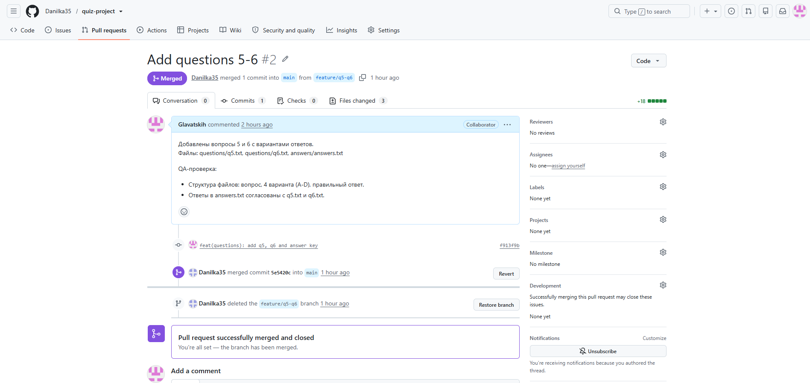

### 7.5. Проверка структуры репозитория (QA)
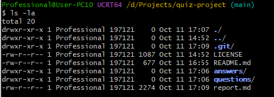
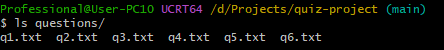
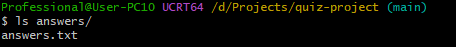

### 7.6. Проверка содержимого вопросов (QA)
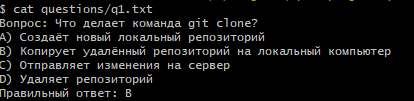
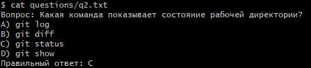
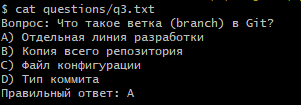
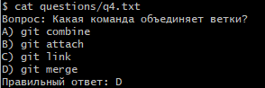
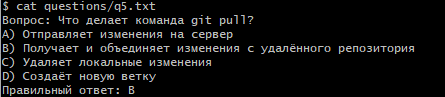
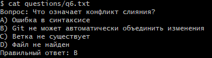
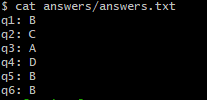

## 8. Возникшие трудности и их решение

| Трудность | Решение |
|-----------|---------|
| Конфликт в `README.md` при слиянии `conflict/a` и `conflict/b` | Разрешён вручную, коммит `25964f2`, маркеры конфликта удалены |
| Ошибочный коммит `01a0967 remove q3, keep only q4` | Вопрос `q3` восстановлен через ветку `feature/q3` |
| Временные файлы `.gitkeep` остались после добавления контента | Удалены на финальном этапе QA (коммит `1c34942`) |

## 9. Выводы
- Командная работа через ветки и Pull Requests выполнена корректно: 5 PR закрыты и смержены в `main`.
- Все 6 вопросов присутствуют, содержимое корректно, ответы в `answers.txt` согласованы с файлами.
- Конфликт разрешён, история коммитов отражает все этапы работы.
- Временные файлы удалены, рабочая директория чиста (`working tree clean`).

**Итог QA:** Проект готов. Замечаний нет.